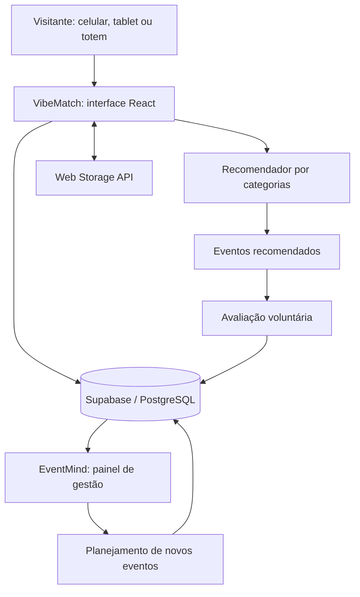

# VibeMind

**Equipe 04 — Mega Beedrill | HackaRun 2026**

**Experiências para todos. Dados para decisões melhores.**

Site para visualização do projeto: [https://github.com/Lu1zR3/Equipe-Mega-Beedrill---HackaRun-](https://lu1zr3.github.io/Equipe-Mega-Beedrill---HackaRun-/demo/)

## Proposta

O **VibeMind** combina duas frentes complementares:

- **VibeMatch:** interface inclusiva que capta preferências dos visitantes e recomenda eventos e experiências com base em seus interesses.
- **EventMind:** painel para a organização visualizar interesses agregados, registrar avaliações e apoiar o planejamento de eventos futuros.

A ideia central é criar um ciclo de melhoria: **escutar → recomendar → planejar → realizar → avaliar → aprender**.

## Problema

Pesquisas exclusivamente digitais podem deixar de fora pessoas sem smartphone, crianças, visitantes com baixa familiaridade tecnológica ou dificuldade de leitura. Assim, as respostas obtidas podem não refletir a diversidade do público do shopping.

A proposta prevê **QR Codes, web app, tablets e coleta presencial assistida**, com perguntas curtas, ícones e áudio (este último como funcionalidade planejada).

## Primeira entrega

📄 [**Planejamento Técnico Inicial — PDF**](docs/Planejamento_Inicial_VibeMind.pdf)

O documento contempla:

1. Proposta e objetivos da solução;
2. Estrutura inicial das telas, com quatro wireframes;
3. Documentação funcional, de inclusão e de privacidade;
4. Linguagem de programação escolhida;
5. Arquitetura e fluxo de dados;
6. Plataforma e tecnologias;
7. Incorporação da tecnologia sorteada **Storage**;
8. Modelo inicial dos dados, escopo do MVP e plano de trabalho.

## Tecnologias propostas

| Camada | Escolha inicial |
| --- | --- |
| Linguagem de programação | JavaScript |
| Interface | HTML, CSS, React e Vite |
| Armazenamento no navegador | **Web Storage API**: `localStorage` e `sessionStorage` |
| Persistência compartilhada | Supabase (PostgreSQL) |
| Visualização | Dashboard web com gráficos simples |
| Recomendação (MVP) | Regras determinísticas de afinidade entre categorias |

> **A confirmar com a organização:** “Storage” foi informado como tecnologia sorteada. **Storage não foi tratado como linguagem de programação.** Nesta proposta, ele é interpretado como requisito de armazenamento, especificamente a Web Storage API. Caso o termo se refira a outra tecnologia, a equipe ajustará a arquitetura conforme a regra oficial.

### Onde entra Storage?

- `localStorage`: preferências de interface e rascunho **não sensível** das escolhas do visitante, quando apropriado.
- `sessionStorage`: progresso temporário da pesquisa durante a sessão.
- **Supabase/PostgreSQL:** respostas persistidas de forma compartilhada para alimentar o dashboard; `localStorage` isolado não substitui um banco central.

Dados sensíveis, senhas e tokens privados **não** devem ser gravados no `localStorage`.

## Arquitetura prevista

## Telas planejadas

- **01 — Boas-vindas:** explicação curta e início sem login obrigatório.
- **02 — Preferências:** seleção visual de temas de interesse; áudio como melhoria planejada.
- **03 — Descoberta:** recomendações de eventos e avaliação opcional.
- **04 — Gestão:** dashboard com indicadores agregados e alertas de lacunas de representatividade.

Os wireframes completos constam no PDF e **não representam telas já implementadas**.

## Escopo inicial do MVP

**Prioridade P0**

- [ ] Catálogo de eventos demonstrativos;
- [ ] Formulário inclusivo de preferências;
- [ ] Recomendador baseado em categorias;
- [ ] Dashboard de interesses e contagens;
- [ ] Uso demonstrável de `localStorage` e `sessionStorage`.

**Se houver tempo (P1/P2)**

- [ ] Cadastro administrativo;
- [ ] Avaliações pós-evento;
- [ ] Apoio por áudio;
- [ ] Sínteses em linguagem natural.

**Importante:** o sistema de recomendação inicial não deve ser apresentado como um modelo de inteligência artificial treinado. IA generativa e predições são possibilidades futuras, não entregas atuais.

## Inclusão e privacidade

A participação deve ser voluntária, com textos simples, contraste adequado, navegação por teclado e alternativas presenciais. Não está prevista coleta de nomes de crianças, geolocalização precisa ou dados sensíveis. As respostas exibidas à gestão devem ser preferencialmente agregadas. Dados fictícios utilizados na demonstração precisam estar identificados como tal.

## Como executar o VibeMind

1. Baixe o repositório e extraia os arquivos.
2. Abra a pasta no Visual Studio Code.
3. Instale a extensão Live Server.
4. Abra `demo/index.html`.
5. Clique em "Open with Live Server".
6. No navegador, acesse as abas Visitante,
   EventMind e Storage.

Consulte as instruções completas em:
[Instruções de execução](docs/INSTRUCOES_DE_EXECUCAO.md)

## Equipe

**Equipe 04 — Mega Beedrill**

- Luiz Fernando Azevedo Jales Pereira
- Fernando Alves Ferreira
- Ítalo Paiva Gracioli
- Pedro Alef da Silva Nunes

## Entrega

- **Primeira entrega:** sexta-feira, **13/11/2026, até 12h**, conforme o enunciado compartilhado.
- **Natureza:** proposta, estrutura de telas e documentação técnica. **Não é ainda a entrega final do MVP.**

## Referências técnicas

- [MDN — Web Storage API](https://developer.mozilla.org/pt-BR/docs/Web/API/Web_Storage_API)
- [MDN — Interface Storage](https://developer.mozilla.org/pt-BR/docs/Web/API/Storage)
